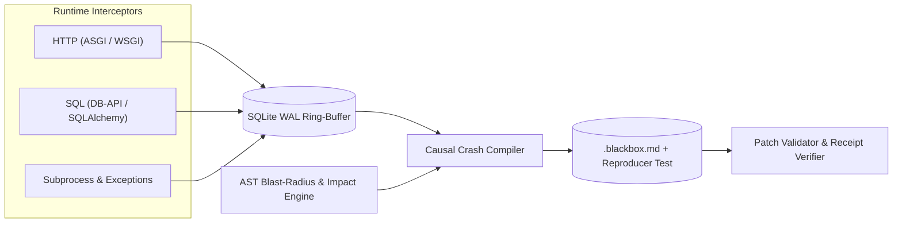

# Genesis Blackbox

[](https://pypi.org/project/genesis-blackbox/)
[](https://www.python.org/downloads/)
[](LICENSE)
[](https://ko-fi.com/johannschiffer)

Deterministic runtime flight recorder, polyglot AST blast-radius analyzer, and causal crash compiler for Python and Node.js/TypeScript services and autonomous AI coding agents.

---

## Overview

When coding agents (Claude Code, Cursor, Windsurf, Antigravity) encounter runtime failures, plain stack traces omit the HTTP/SQL/subprocess events that preceded the error, the local variable bindings inside each frame, and the static call-graph impact of a proposed fix.

`genesis-blackbox` records runtime context with zero external runtime dependencies:

1. **SQLite WAL Ring-Buffer (`wal_ring.py`):** Bounded circular log for HTTP transactions, SQL queries with redacted bind parameters, subprocess invocations, and exceptions.
2. **Deep Exception Serializer (`exception_hook.py`):** Captures per-frame local variable scopes across `sys.excepthook` and `threading.excepthook` with circular-reference bounds and secret redaction.
3. **Polyglot Node.js & TypeScript Support (`ast_engine/polyglot.py`, `recorder/node_preload.py`):** Pure-Python lexical parser extracting imports, exports, functions, and Next.js route boundaries across `.ts`, `.tsx`, `.js`, `.jsx`. Active Node preload interceptor hooks `fetch`, `http.request`, `uncaughtException`, and `unhandledRejection` with header redaction.
4. **Time-Travel Execution Differ (`compiler/state_differ.py`):** Compares healthy baseline runs against failing runs, pinpointing the exact divergence point in SQL queries, HTTP schemas, and variable states.
5. **Portable Crash Incident Bundler (`recorder/bundle.py`):** Safely snapshots WAL databases via SQLite Online Backup API and creates tamper-evident incident archives (`.zip`) with SHA-256 integrity verification.
6. **Zero-Config & Framework Instrumentation (`instrumentation.py`, `integrations/`):** Drop-in `auto_instrument()` plus idiomatic adapters for FastAPI/Starlette (ASGI), Flask (WSGI), sqlite3/DB-API, and SQLAlchemy.
7. **AST Blast-Radius & Impact Selector (`ast_engine/`):** Static call-graph analyzer that computes upstream callers, downstream callees, and impacted test suites (`pytest` or `node --test`) for modified code.
8. **Causal Crash Compiler, Reproducer & Patch Validator (`compiler/`):** Compiles `.blackbox.md` autopsy capsules, synthesizes standalone Python (`pytest`) or Node.js (`node:test`) reproduction scripts, validates candidate `git diff` patches with guaranteed rollback, and writes `.blackbox-resolved.md` verification receipts.
9. **Pytest Plugin & GitHub Actions Summary (`pytest_plugin.py`, `ci/`):** Native `pytest --blackbox` hook and collapsible `$GITHUB_STEP_SUMMARY` Markdown exporter.
10. **Native MCP Server & Live SSE Web Inspector (`mcp_server.py`, `ui/`):** Stdio MCP server (`blackbox-mcp`) exposing 11 diagnostic tools alongside a localhost timeline viewer with live Server-Sent Events (SSE) streaming (`GET /api/live`).

---

## Architecture



---

## Quickstart

### 1. Installation

```bash
pip install genesis-blackbox
```

### 2. Record Any Python Command or Service

```bash
blackbox record -- python app.py
```

Or attach inside application code with one line:

```python
from blackbox import auto_instrument

auto_instrument(db_path=".blackbox/wal.sqlite")
```

Framework-specific helpers are also included:

```python
from blackbox import instrument_fastapi, instrument_flask, instrument_engine

instrument_fastapi(fastapi_app)
instrument_flask(flask_app)
instrument_engine(sqlalchemy_engine)
```

### 3. Pytest Plugin & Impact Test Selection

Capture autopsies and standalone reproduction scripts automatically on test failures:

```bash
pytest --blackbox
```

Select and execute only the tests affected by modified source symbols:

```bash
blackbox test-impact --diff --run
```

### 4. Compile Autopsies, Reproduce, and Verify Fixes

```bash
# Compile .blackbox.md from the latest crash in .blackbox/wal.sqlite
blackbox autopsy

# Compare baseline healthy run against latest failing run (Time-Travel Diff)
blackbox diff-runs [--output .blackbox-diff.md]

# Synthesize all-in-one AI agent repair prompt packet with polyglot code fences
blackbox pack [--output prompt.md]

# Synthesize a standalone reproduction script (pytest for Python, node:test for Node.js)
blackbox reproduce [--output test_blackbox_reproduce.py]

# Run the reproduction test and emit .blackbox-resolved.md once fixed
blackbox verify [--test test_blackbox_reproduce.py]

# Create a portable incident archive (.zip) with WAL snapshot and SHA-256 manifest
blackbox bundle create [--output crash_bundle.zip]

# Inspect and verify the integrity of a crash bundle archive without extraction
blackbox bundle inspect crash_bundle.zip [--json]

# Export collapsible Markdown to GitHub Actions $GITHUB_STEP_SUMMARY
blackbox ci-summary --autopsy .blackbox.md

# Initialize agent workflow rules (.cursorrules, CLAUDE.md, or .windsurfrules)
blackbox init-rules --type claude

# Launch the localhost timeline and autopsy web inspector with live SSE streaming
blackbox ui --port 8765 --no-browser
```

---

## MCP Server Configuration

`genesis-blackbox` ships the `blackbox-mcp` stdio server exposing 11 diagnostic and repair tools:

- `get_crash_autopsy`: Compiles `.blackbox.md` from recorded WAL events.
- `compare_execution_runs`: Compares baseline passing run against failing run to pinpoint SQL, HTTP, and variable divergence.
- `get_blast_radius`: Computes upstream callers and downstream callees across Python and TypeScript/JavaScript.
- `generate_reproduction_test`: Synthesizes an executable reproduction script (`pytest` or `node:test`) from the latest crash.
- `get_repair_prompt`: Generates complete AI repair prompt packet with reproduction test, blast radius, and diff.
- `test_candidate_patch`: Evaluates candidate `git diff` against reproduction and AST-impacted tests with automatic rollback.
- `verify_crash_resolution`: Executes the reproduction test and emits `.blackbox-resolved.md` when resolved.
- `create_crash_bundle`: Snapshots active WAL and packages an incident archive (`.zip`) with SHA-256 verification manifest.
- `inspect_crash_bundle`: Verifies integrity of a shareable crash bundle without extracting to disk.
- `query_execution_timeline`: Queries recent HTTP, SQL, subprocess, and exception events.
- `record_event`: Appends structured execution telemetry to the circular WAL buffer.

### Claude Desktop / Cursor / Windsurf

```json
{
  "mcpServers": {
    "blackbox": {
      "command": "uvx",
      "args": ["--from", "genesis-blackbox", "blackbox-mcp"]
    }
  }
}
```

If installed into an active virtual environment, you can invoke `blackbox-mcp` directly:

```json
{
  "mcpServers": {
    "blackbox": {
      "command": "blackbox-mcp",
      "args": ["--db", ".blackbox/wal.sqlite"]
    }
  }
}
```

---

## Support

If this project is useful in your engineering workflow, you can support ongoing open-source maintenance on [Ko-fi](https://ko-fi.com/johannschiffer).

---

## License

Licensed under the [MIT License](LICENSE). Copyright (c) Johann Schiffer.
