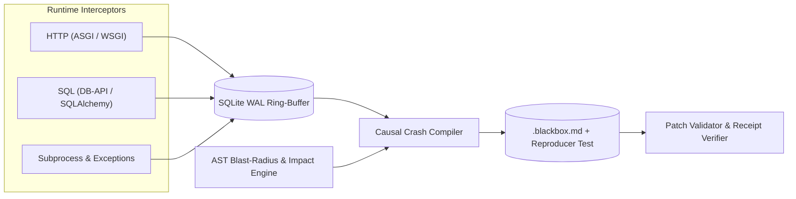

# Genesis Blackbox

[](https://pypi.org/project/genesis-blackbox/)
[](https://www.python.org/downloads/)
[](LICENSE)
[](https://ko-fi.com/johannschiffer)

Deterministic runtime flight recorder, polyglot AST blast-radius analyzer, and causal crash compiler for Python and Node.js/TypeScript services and autonomous AI coding agents.

---

## Overview

When coding agents (Claude Code, Cursor, Windsurf, Antigravity) encounter runtime failures, plain stack traces omit the HTTP/SQL/subprocess events that preceded the error, the local variable bindings inside each frame, and the static call-graph impact of a proposed fix.

`genesis-blackbox` records runtime context with zero external runtime dependencies:

1. **SQLite WAL Ring-Buffer (`wal_ring.py`):** Bounded circular log for HTTP transactions, SQL queries with redacted bind parameters, subprocess invocations, and exceptions.
2. **Deep Exception Serializer (`exception_hook.py`):** Captures per-frame local variable scopes across `sys.excepthook` and `threading.excepthook` with circular-reference bounds and secret redaction.
3. **Polyglot Node.js & TypeScript Support (`ast_engine/polyglot.py`, `recorder/node_preload.py`):** Pure-Python lexical parser extracting imports, exports, functions, and Next.js route boundaries across `.ts`, `.tsx`, `.js`, `.jsx`. Active Node preload interceptor hooks `fetch`, `http.request`, `uncaughtException`, and `unhandledRejection` with header redaction.
4. **Time-Travel Execution Differ (`compiler/state_differ.py`):** Compares healthy baseline runs against failing runs, pinpointing the exact divergence point in SQL queries, HTTP schemas, and variable states.
5. **Portable Crash Incident Bundler (`recorder/bundle.py`):** Safely snapshots WAL databases via SQLite Online Backup API and creates tamper-evident incident archives (`.zip`) with SHA-256 integrity verification.
6. **Zero-Config & Framework Instrumentation (`instrumentation.py`, `integrations/`):** Drop-in `auto_instrument()` plus idiomatic adapters for FastAPI/Starlette (ASGI), Flask (WSGI), sqlite3/DB-API, and SQLAlchemy.
7. **AST Blast-Radius & Impact Selector (`ast_engine/`):** Static call-graph analyzer that computes upstream callers, downstream callees, and impacted test suites (`pytest` or `node --test`) for modified code.
8. **Causal Crash Compiler, Reproducer & Patch Validator (`compiler/`):** Compiles `.blackbox.md` autopsy capsules, synthesizes standalone Python (`pytest`) or Node.js (`node:test`) reproduction scripts, validates candidate `git diff` patches with guaranteed rollback, and writes `.blackbox-resolved.md` verification receipts.
9. **Pytest Plugin, Auto-Baseline Rotation & GitHub Actions Summary (`pytest_plugin.py`, `baseline.py`, `ci/`):** Native `pytest --blackbox` hook with atomic clean-run baseline promotion (`.blackbox/wal.baseline.sqlite`, opt-out via `--no-auto-baseline`), automatic `.blackbox-diff.md` divergence generation on failure, and collapsible `$GITHUB_STEP_SUMMARY` Markdown exporter.
10. **Surgical Watch Mode (`watcher.py`):** Zero-dependency `os.stat` source watcher (`blackbox watch`) that selects and runs only AST-impacted tests on edits, rotating baselines on pass and compiling crash artifacts on failure.
11. **Async TraceContext, N+1 SQL & Flake Analyzer (`context.py`, `perf_detector.py`, `flake_analyzer.py`):** `contextvars`-isolated async request tracing across `asyncio.gather`, N+1 SQL fingerprint clustering (`## Performance & N+1 Query Diagnostics` in `.blackbox.md`), baseline latency regression detection, and non-determinism/flakiness classification (`blackbox diagnose-perf`).
12. **Offline Egress Mocker, Resource Profiler & Autonomous Heal Planner (`egress_mocker.py`, `resource_profiler.py`, `heal_planner.py`):** Sanitized outbound HTTP capture (`urllib.request.urlopen`, plus optional `requests` and `httpx` when installed) automatically wired into `blackbox record`, `auto_instrument()`, and `pytest --blackbox` with `unittest.mock` offline stub injection into `CrashReproducer`, stdlib `tracemalloc` + `gc` + `/proc/self/fd` memory profiling (`--profile` / `--blackbox-profile`), and deterministic 4-step repair planning (`blackbox heal-plan`).
13. **Unified MCP Stack Provisioner, Doctor & Operational Incident Compiler (`stack.py`, `autopsy.py`):** Non-destructive client stack config provisioning (`blackbox init-stack` supporting `cursor`, `claude`, `claude-code`, `windsurf`, `vscode`, and `antigravity`) linking `blackbox-mcp` and the 6 Genesis MCP servers (`v2.1.0`) to one WAL, environment diagnostics (`blackbox doctor`), cross-server telemetry diagnostics (`blackbox ecosystem` / `diagnose_mcp_ecosystem`), `MCP_TOOL` timeline rendering, and `# ⚠️ BLACKBOX OPERATIONAL INCIDENT CAPSULE` generation for non-exception tool errors.
14. **Native MCP Server (Tools + Resources + Prompts) & Live SSE Web Inspector (`mcp_server.py`, `ui/`):** Stdio MCP server (`blackbox-mcp`) exposing 15 diagnostic tools, 4 MCP resources (`blackbox://autopsy/latest`, `blackbox://heal-plan/latest`, `blackbox://ecosystem/health`, `blackbox://timeline/recent`), and 2 MCP prompts (`repair-latest-crash`, `audit-mcp-stack`), alongside a localhost timeline viewer with live Server-Sent Events (SSE), timeline filters, ZIP bundle export, and tabbed Ecosystem / Performance / Heal Plan diagnostics.

---

## Architecture



---

## Quickstart

### 1. Installation

Zero external runtime dependencies (pure Python 3.10+ standard library):

```bash
pip install genesis-blackbox
# Optional pytest integration plugin:
pip install "genesis-blackbox[pytest]"
```

### 2. Record Any Python Command or Service

```bash
blackbox record [--profile] [--capture-sql] [--no-egress-mock] -- python app.py
```

Or attach inside application code with one line:

```python
from blackbox import auto_instrument

auto_instrument(db_path=".blackbox/wal.sqlite")
```

Framework-specific helpers are also included:

```python
from blackbox import instrument_fastapi, instrument_flask, instrument_engine

instrument_fastapi(fastapi_app)
instrument_flask(flask_app)
instrument_engine(sqlalchemy_engine)
```

### 3. Pytest Plugin, Auto-Baseline & Surgical Watch Mode

Capture autopsies, standalone reproduction scripts, egress stubs, optional memory/FD profiling, and automatic clean-run baseline snapshots (`wal.baseline.sqlite`):

```bash
pytest --blackbox [--blackbox-profile] [--no-egress-mock] [--no-auto-baseline]
```

Monitor source files and surgically run only impacted tests on modification:

```bash
blackbox watch [--root .] [--interval 1.0] [--once]
```

Select and execute only the tests affected by modified source symbols:

```bash
blackbox test-impact --diff --run
```

### 4. Compile Autopsies, Reproduce, and Verify Fixes

```bash
# Compile .blackbox.md from the latest crash in .blackbox/wal.sqlite
blackbox autopsy

# Compare baseline healthy run against latest failing run (Time-Travel Diff)
blackbox diff-runs [--output .blackbox-diff.md]

# Synthesize all-in-one AI agent repair prompt packet with polyglot code fences
blackbox pack [--output prompt.md]

# Synthesize a standalone reproduction script (pytest for Python, node:test for Node.js)
blackbox reproduce [--output test_blackbox_reproduce.py]

# Run the reproduction test and emit .blackbox-resolved.md once fixed
blackbox verify [--test test_blackbox_reproduce.py]

# Create a portable incident archive (.zip) with WAL snapshot and SHA-256 manifest
blackbox bundle create [--output crash_bundle.zip]

# Inspect and verify the integrity of a crash bundle archive without extraction
blackbox bundle inspect crash_bundle.zip [--json]

# Diagnose N+1 SQL queries, baseline latency regressions, and test flakiness
blackbox diagnose-perf [--db .blackbox/wal.sqlite] [--baseline .blackbox/wal.baseline.sqlite] [--threshold 5] [--json]

# Generate deterministic 4-phase autonomous heal plan combining crash, egress stubs, perf/memory, and impacted tests
blackbox heal-plan [--db .blackbox/wal.sqlite] [--baseline .blackbox/wal.baseline.sqlite] [--root .] [--json]

# Export collapsible Markdown to GitHub Actions $GITHUB_STEP_SUMMARY
blackbox ci-summary --autopsy .blackbox.md

# Initialize agent workflow rules (.cursorrules, CLAUDE.md, or .windsurfrules)
blackbox init-rules --type claude

# Provision unified MCP stack config sharing one WAL database across all 7 Genesis servers
blackbox init-stack --client cursor [--output .cursor/mcp.json] [--db .blackbox/wal.sqlite]
# Supported clients: cursor, claude, claude-code, windsurf, vscode, antigravity

# Diagnose cross-server Genesis MCP telemetry from the shared WAL
blackbox ecosystem [--db .blackbox/wal.sqlite] [--json]

# Verify runtime, WAL health, Node/Git, and Genesis MCP stack readiness
blackbox doctor [--db .blackbox/wal.sqlite] [--root .] [--json]

# Launch the localhost timeline and autopsy web inspector with live SSE streaming
blackbox ui --port 8765 --no-browser
```

---

## Interactive Examples & Benchmarks (`examples/`)

Self-contained executable demonstrations covering the primary real-world workflows through v1.0.0:

### 1. Python Time-Travel SQL & State Divergence (`examples/01_python_time_travel_diff/`)
Executes an order checkout pipeline across two consecutive runs (healthy baseline vs failing run with silent discount multiplier mutation to `None`). Invokes `CausalCrashCompiler` (`.blackbox.md`) and `StateDiffer` (`.blackbox-diff.md`) to pinpoint the exact divergence point and failing database constraint.
```bash
python examples/01_python_time_travel_diff/run_demo.py
```

### 2. Node.js / TypeScript Runtime Preload & V8 Reproducer (`examples/02_node_ts_async_crash/`)
Runs a Node.js/TypeScript asynchronous service with the zero-dependency `NODE_OPTIONS` preload interceptor active. Proves automatic in-flight credential redaction (`Authorization: Bearer ...`, `Cookie: ...`, `?api_key=...`), computes polyglot AST blast-radius across `.mjs`/`.ts` files, and synthesizes a standalone `node:test` reproduction script (`test_blackbox_reproduce.mjs`).
```bash
python examples/02_node_ts_async_crash/run_demo.py
```

### 3. Autonomous 1-Shot Agent Repair Loop (`examples/03_autonomous_patch_loop/`)
Executes the full 5-phase autonomous AI agent repair lifecycle inside an isolated sandbox: records a crashing target (`run_target`), synthesizes reproduction test (`CrashReproducer`), generates context-dense prompt packet (`PromptSynthesizer`), validates candidate unified diff patch with guaranteed rollback safety (`PatchValidator.evaluate_patch`), and issues cryptographic verification receipt (`CausalVerifier` -> `.blackbox-resolved.md`).
```bash
python examples/03_autonomous_patch_loop/run_demo.py
```

### 4. Async TraceContext, N+1 SQL & Offline Egress Heal Loop (`examples/04_async_n1_egress_heal_loop/`)
Executes an async order workflow against a local ephemeral `HTTPServer` with `TraceContext`, `EgressMocker`, `ResourceProfiler`, and `SqlInterceptor` active. Proves automatic URL secret redaction, N+1 SQL detection, offline `unittest.mock` stub synthesis, and 4-step `AutonomousHealPlanner` generation.
```bash
python examples/04_async_n1_egress_heal_loop/run_demo.py
```

### 5. Genesis MCP Stack Operational Incident (`examples/05_genesis_mcp_stack_incident/`)
Simulates multi-server `MCP_TOOL` telemetry (`pgsafe-mcp`, `sysflow-mcp`, `crawlengine-mcp`, `browserbridge-mcp`) sharing one WAL, compiling `# ⚠️ BLACKBOX OPERATIONAL INCIDENT CAPSULE` and cross-server ecosystem health diagnostics.
```bash
python examples/05_genesis_mcp_stack_incident/run_demo.py
```

---

## MCP Server Configuration

`genesis-blackbox` ships the `blackbox-mcp` stdio server exposing 15 diagnostic and repair tools:

- `get_full_incident_context`: 1-call unified payload returning `autopsy_markdown`, `baseline_diff`, `reproduction_test`, `impacted_tests`, `performance_and_flakiness`, `egress_stubs`, `resource_profile`, and `mcp_ecosystem`.
- `diagnose_mcp_ecosystem`: Aggregates per-server invocation counts, latency, security guard blocks, and operational errors across all connected Genesis MCP servers.
- `get_autonomous_heal_plan`: Synthesizes a deterministic 4-step remediation plan combining root cause, offline HTTP egress stubs, performance/memory alerts, baseline divergence, and impacted regression tests.
- `diagnose_performance_and_flakiness`: Detects N+1 SQL query loops, baseline latency regressions, and test flakiness causes.
- `get_crash_autopsy`: Compiles `.blackbox.md` from recorded WAL events.
- `compare_execution_runs`: Compares baseline passing run against failing run to pinpoint SQL, HTTP, and variable divergence.
- `get_blast_radius`: Computes upstream callers and downstream callees across Python and TypeScript/JavaScript.
- `generate_reproduction_test`: Synthesizes an executable reproduction script (`pytest` or `node:test`) from the latest crash.
- `get_repair_prompt`: Generates complete AI repair prompt packet with reproduction test, blast radius, and diff.
- `test_candidate_patch`: Evaluates candidate `git diff` against reproduction and AST-impacted tests with automatic rollback.
- `verify_crash_resolution`: Executes the reproduction test and emits `.blackbox-resolved.md` when resolved.
- `create_crash_bundle`: Snapshots active WAL and packages an incident archive (`.zip`) with SHA-256 verification manifest.
- `inspect_crash_bundle`: Verifies integrity of a shareable crash bundle without extracting to disk.
- `query_execution_timeline`: Queries recent HTTP, SQL, subprocess, and exception events.
- `record_event`: Appends structured execution telemetry to the circular WAL buffer.

### Claude Desktop / Cursor / Windsurf

```json
{
  "mcpServers": {
    "blackbox": {
      "command": "uvx",
      "args": ["--from", "genesis-blackbox", "blackbox-mcp"]
    }
  }
}
```

If installed into an active virtual environment, you can invoke `blackbox-mcp` directly:

```json
{
  "mcpServers": {
    "blackbox": {
      "command": "blackbox-mcp",
      "args": ["--db", ".blackbox/wal.sqlite"]
    }
  }
}
```

---

## Support

If this project is useful in your engineering workflow, you can support ongoing open-source maintenance on [Ko-fi](https://ko-fi.com/johannschiffer).

---

## License

Licensed under the [MIT License](LICENSE). Copyright (c) Johann Schiffer.
