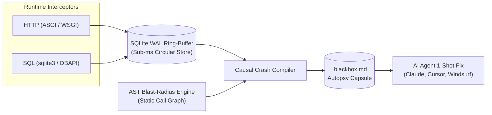

# Genesis Blackbox

[](https://www.python.org/downloads/)
[](LICENSE)
[](https://ko-fi.com/johannschiffer)

Deterministic Runtime Flight Recorder and AST Blast-Radius Causal Crash Compiler for AI-assisted engineering and autonomous coding agents.

---

## Overview

When coding agents (Claude, Cursor, Windsurf) encounter runtime crashes, standard stack traces leave them guessing. They lack the execution history leading up to the error, the local variable state across stack frames, and the static dependency blast radius.

**Genesis Blackbox** captures execution context with sub-millisecond overhead:
1. **SQLite WAL Ring-Buffer (`wal_ring.py`):** Circular bounded log for HTTP requests, SQL queries with sanitized parameters, and subprocess activity.
2. **Deep Exception Serializer (`exception_hook.py`):** Automatically captures local variables per frame at crash time with circular-reference safety and credential redaction.
3. **AST Blast-Radius Engine (`ast_engine/`):** Static call-graph analyzer that maps upstream callers and downstream callee dependencies.
4. **Causal Crash Compiler (`compiler/`):** Synthesizes timeline events, frame variables, and AST blast radius into a self-contained `.blackbox.md` Autopsy Capsule.
5. **Native MCP Server (`mcp_server.py`):** Direct Model Context Protocol interface exposing timeline queries, crash autopsies, and blast-radius tools over stdio.
6. **Embedded Visual Timeline (`ui/`):** Lightweight local web inspector for timeline events and crash autopsies.

---

## Architecture



```text
+-------------------------------------------------+
|              Runtime Interceptors               |
|      ASGI / WSGI Middleware & SQL Drivers       |
+------------------------+------------------------+
                         |
                         v
+-------------------------------------------------+
|             SQLite WAL Ring-Buffer              |
|        (Sub-ms Overhead, Circular Pruning)      |
+------------------------+------------------------+
                         |                  +-----------------------------+
                         |                  |   AST Blast-Radius Engine   |
                         |                  |   (Static Call Graph Nodes) |
                         +--------+---------+--------------+--------------+
                                  |                        |
                                  v                        v
                         +------------------------------------------------+
                         |             Causal Crash Compiler              |
                         +------------------------+-----------------------+
                                                  |
                                                  v
                         +------------------------------------------------+
                         |              .blackbox.md Capsule              |
                         |     (Timeline + Frame State + Blast Radius)    |
                         +------------------------+-----------------------+
                                                  |
                                                  v
                         +------------------------------------------------+
                         |        AI Agent 1-Shot Deterministic Fix       |
                         |           (Claude, Cursor, Windsurf)           |
                         +------------------------------------------------+
```

---

## Quickstart

### 1. Installation

```bash
pip install genesis-blackbox
```

For development dependencies (pytest, pytest-asyncio, build, twine):

```bash
pip install genesis-blackbox[dev]
```

### 2. Frictionless Recording

Execute any Python entrypoint or microservice under the flight recorder wrapper:

```bash
blackbox record -- python app.py
```

The flight recorder automatically:
- Initializes a local bounded SQLite WAL ring buffer at `.blackbox/wal.sqlite`.
- Hooks `sys.excepthook` and `threading.excepthook` for deep variable serialization upon crash.
- Redacts sensitive headers (Authorization, Cookie, API keys) and SQL credentials.

You can also record custom events directly from the CLI or your code:

```bash
blackbox record --type HTTP_REQ --payload '{"path": "/api/users", "status": 500, "error": "DatabaseTimeout"}'
```

### 3. Visual Inspection

Launch the embedded local web inspector to explore recent events, execution timelines, and crash autopsy capsules:

```bash
blackbox ui --port 8765
```

Navigate to `http://127.0.0.1:8765` in your browser.

### 4. Causal Autopsy Generation

Generate a complete Markdown autopsy document from the latest recorded crash:

```bash
blackbox autopsy
```

This compiles `.blackbox.md` in the current directory with:
- Target exception class, message, and formatted traceback.
- Local variables across each stack frame.
- Recent execution timeline leading to the crash.
- AST blast-radius analysis showing impacted callers and callees.

To inspect the recent execution timeline via CLI:

```bash
blackbox timeline --limit 20
```

To run a blast-radius calculation on a file or specific symbol:

```bash
blackbox blast-radius app.py --symbol handle_request
```

---

## MCP Server Configuration

Genesis Blackbox includes a native Model Context Protocol (MCP) server (`blackbox.mcp_server`) exposing diagnostic tools directly to AI coding agents.

Exposed MCP tools:
- `get_crash_autopsy`: Compiles `.blackbox.md` from recorded WAL events.
- `get_blast_radius`: Analyzes upstream and downstream code dependencies.
- `query_execution_timeline`: Queries recent HTTP, SQL, and exception events.
- `record_event`: Ingests custom execution events into the WAL ring buffer.

### Claude Desktop

Add to your `claude_desktop_config.json`:

```json
{
  "mcpServers": {
    "blackbox": {
      "command": "python",
      "args": ["-m", "blackbox.mcp_server"]
    }
  }
}
```

### Cursor

Add to your `.cursor/mcp.json`:

```json
{
  "mcpServers": {
    "blackbox": {
      "command": "python",
      "args": ["-m", "blackbox.mcp_server"]
    }
  }
}
```

### Windsurf

Add to `~/.codeium/windsurf/mcp_config.json`:

```json
{
  "mcpServers": {
    "blackbox": {
      "command": "python",
      "args": ["-m", "blackbox.mcp_server"]
    }
  }
}
```

---

## Support and Sponsorship

Genesis Blackbox is 100% free and open-source software under the MIT license.

If this tool accelerates your development or helps your AI agents resolve bugs deterministically, consider supporting ongoing development:

[](https://ko-fi.com/johannschiffer)

Support page: [https://ko-fi.com/johannschiffer](https://ko-fi.com/johannschiffer)

---

## License

This project is licensed under the [MIT License](LICENSE).
Copyright (c) Johann Schiffer.
